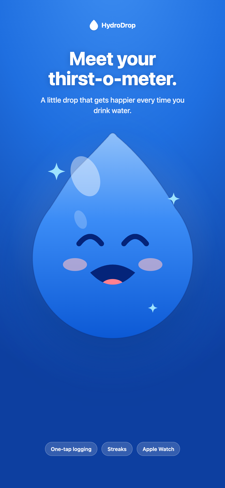

# HydroDrop

A water-tracking app for iPhone and Apple Watch, built around a droplet mascot that reacts as you get closer to your daily goal. It's live at [hydrodrop.us](https://hydrodrop.us).



## The problem

Most hydration apps fail at the moment that matters: logging a drink takes enough taps that people stop doing it within a week. HydroDrop tries to make logging cost close to nothing. You can tap a widget, tap an NFC sticker on your bottle, or just say "I had a large coffee." It also adds a light social layer (Duo Streaks) so that two people keep each other going.

## What it does

- **Fast logging:** quick-add buttons, home and lock screen widgets, a Live Activity, and an Apple Watch app.
- **Bottle tags:** an NFC sticker logs a whole bottle with one tap.
- **Say it:** natural-language logging using Apple's on-device FoundationModels on iOS 26. It's gated behind `#available` so the app still runs on iOS 17.
- **Duo Streaks:** a shared daily-goal streak between two people, on iPhone and Android, backed by a server I also wrote ([HydroDrop-Server](#related-repos)).
- **HealthKit sync**, weather-adjusted goals, reminders during waking hours, caffeine tracking, and weekly recaps.
- **HydroDrop+** subscription (monthly, yearly, or lifetime) through StoreKit 2. Free users outside the EEA, UK, and Switzerland see one AdMob banner.

## Architecture

```
┌──────────── iPhone app (SwiftUI) ────────────┐   ┌──── Watch app ────┐
│ Views ─ Models (SwiftData) ─ StoreKit 2      │   │ WatchConnectivity │
│ Widgets / Live Activity / App Intents / NFC  │◄─►│                   │
│ HealthKit ─ Weather ─ FoundationModels       │   └───────────────────┘
│                                              │
│ Duo: API client, sync engine, op queue,      │
│      App Attest, Keychain identity           │
└──────┬─────────────────────────┬─────────────┘
       │ SwiftData + CloudKit    │ HTTPS (OpenAPI contract v1)
       ▼                         ▼
 user's private iCloud    Cloudflare Worker (D1, Queues, KV, R2)
                           → APNs / FCM push
            ▲
            │ shared rules + test vectors
     HydroCore (Swift package, Foundation only)
```

**Key decisions**

- **No accounts. Data lives in the user's own iCloud.** SwiftData with CloudKit gives sync across devices for free and means I don't hold anyone's health data. Duo is the only feature that talks to my server, and it stores the minimum it needs to compare streaks.
- **Days are stored as `"YYYY-MM-DD"` strings, not `Date`s** (`HydroCore/Sources/HydroCore/DayKey.swift`). A `Date` is an instant in time. "Today" stored in New York becomes "yesterday" when it's read in London, which silently broke streak freezes. A day key means the same day everywhere.
- **One source of truth for the streak rules across three codebases.** `HydroCore` is a dependency-free Swift package. It exports JSON test vectors (`HydroCore/Tests/Vectors/duo-vectors-v1.json` plus a SHA-256 checksum) that the TypeScript server and the Kotlin Android app run against. If any of the three implementations drifts, its tests fail.
- **An offline-safe op queue** (`DuoOpQueue.swift`). Leave, block, and profile changes have to reach the server even if the app is killed. The queue keeps strict ordering only inside each group of related requests, so a rate-limited rename can't hold a Block back for a day.

## Tech stack

Swift (5 language mode), SwiftUI, SwiftData + CloudKit, StoreKit 2, WidgetKit, ActivityKit, App Intents, Core NFC, HealthKit, WeatherKit, FoundationModels, App Attest, Google Mobile Ads. The project is generated with XcodeGen and CI runs on Xcode Cloud.

## Testing

- About 110 test files (~49k lines): unit tests for the app and `HydroCore`, plus robustness tests for the Duo sync, joining, and exit flows, and UI tests that produce the App Store screenshots.
- `Scripts/preflight.sh` checks for the causes of past App Review rejections before every release, and checks that the CloudKit production schema matches every `@Model`.

## Running it

Requires Xcode 26 or later and [XcodeGen](https://github.com/yonaskolb/XcodeGen).

```bash
git clone https://github.com/Jonathon-Brown/HydroDrop.git
cd HydroDrop
Scripts/generate.sh          # generates HydroDrop.xcodeproj and patches the StoreKit config
open HydroDrop.xcodeproj     # run the HydroDrop scheme on an iOS 17+ simulator
```

Duo Streaks is compiled out of Debug builds unless you enable it in `Config/Duo.local.xcconfig`. Everything else runs without a server.

Run the `HydroCore` tests on their own:

```bash
cd HydroCore && swift test
```

## Repo layout

| Path | What's there |
| --- | --- |
| `HydroDrop/` | The iPhone app, grouped by feature (Views, Models, Duo, Health, StoreKit, NFC, ...) |
| `HydroDrop Watch App/`, `HydroDropWidgets/` | Watch app and widget extension |
| `HydroCore/` | Shared rules package and cross-platform test vectors |
| `HydroDropTests/`, `HydroDropScreenshotUITests/` | Tests |
| `Scripts/` | Project generation, release, and preflight checks |
| `docs/` | Source for hydrodrop.us (GitHub Pages) |

## Related repos

- **HydroDrop-Server** (private): the Duo Streaks API, a Cloudflare Worker in TypeScript.
- **HydroDrop-Android** (private): the Android client for Duo Streaks.

## How I built it

I built HydroDrop with AI coding agents (Claude Code) doing much of the typing. I wrote the specs and made the architecture decisions, and I reviewed and tested everything on real devices before it shipped. Design decisions are recorded in the code comments next to the code they affect.

© 2026 Jonathon Brown
